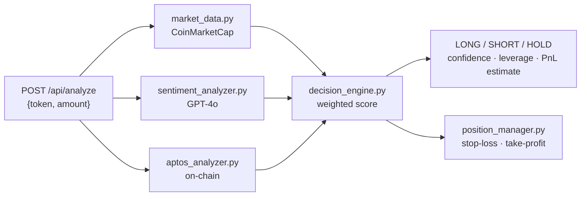

# SentenexAI

### Sentiment and on-chain analyzer for perpetual trading on Aptos


This repo is the standalone Python service behind **Sentenex**. It combines CoinMarketCap market data, GPT-4o sentiment analysis, and Aptos on-chain metrics into a LONG / SHORT / HOLD recommendation, with a confidence score and suggested leverage.

The full app (React dashboard, plus an Express backend that executes trades on Kana Perps) is in **[AptosHack](https://github.com/Devanshgoel-123/AptosHack)**.

The complete service documentation (setup, endpoints, polling, and examples) is in **[Sentenex-main/README.md](Sentenex-main/README.md)**.



## Quick start

```bash
cd Sentenex-main
pip install -r requirements.txt
printf "CMC_API_KEY=...\nOPENAI_API_KEY=...\n" > .env
python app.py            # http://localhost:8000/docs
```
